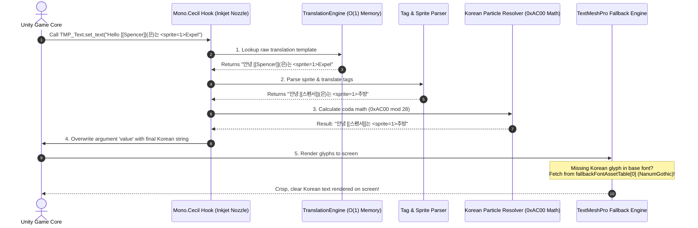

# Unity IL Localization Toolkit (UIL-Toolkit)

<div align="center">


)-red.svg)


**유니티 게임을 위한 스탠드얼론 IL 바이트코드 인젝션 및 실시간 한글화 프레임워크**  
*A High-Performance Standalone Unity Game Localization & Dynamic IL Bytecode Injection Engine*

</div>

---

## 📖 목차 (Table of Contents)
1. [프로젝트 소개 (Introduction)](#-프로젝트-소개-introduction)
2. [5대 핵심 기술 기둥 (5 Core Breakthroughs)](#-5대-핵심-기술-기둥-5-core-breakthroughs)
   - [1. IL 바이트코드 인젝션: "잉크젯 노즐 가로채기"](#1-il-바이트코드-인젝션-잉크젯-노즐-바로-앞에서-가로채기)
   - [2. O(1) 초고속 인메모리 딕셔너리](#2-o1-초고속-인메모리-딕셔너리-조회)
   - [3. 실시간 조사 수학 계산기](#3-실시간-조사은는-이가-을를-수학-계산기)
   - [4. 복합 스프라이트 및 문법 파서](#4-복합-스프라이트-및-문법-파서-tagandspriteparser)
   - [5. TextMeshPro 런타임 폰트 폴백 강제 주입](#5-textmeshpro-런타임-폰트-폴백fallback-font-강제-주입)
3. [전체 시스템 아키텍처 (Architecture Diagram)](#-전체-시스템-아키텍처-architecture-diagram)
4. [저장소 구조 (Repository Structure)](#-저장소-구조-repository-structure)
5. [빠른 시작 가이드 (Quick Start)](#-빠른-시작-가이드-quick-start)
   - [빌드 방법 (Build)](#1-원클릭-빌드-build)
   - [대화형 데모 실행 (Interactive Demo)](#2-대화형-기술-쇼케이스-실행-interactivedemoexe)
   - [게임에 패치 주입 (Inject into Game)](#3-실제-게임에-패치-주입-assemblypatcherexe)
6. [상세 문서 (Detailed Documents)](#-상세-문서-detailed-documents)
7. [라이선스 (License)](#-라이선스-license)

---

## 💡 프로젝트 소개 (Introduction)

스팀(Steam)의 많은 해외 인디 유니티(Unity) 게임들은 다국어 지원 설계가 전혀 되어 있지 않습니다:
- 텍스트가 C# 코드 및 메서드 반환값에 하드코딩되어 외부 리소스 파일이 없음
- 영문 기본 폰트만 탑재되어 한글을 출력하면 사각형(ㅁㅁㅁ)으로 깨지는 글리프 누락 발생
- BepInEx, MelonLoader 등 기존 모드 로더는 수백 MB의 런타임 설치가 필요하고 버전 충돌이 빈번함
- 게임 대사 안에 실시간 변수(`[[Spencer]]`, `[[Knock]]`)가 섞여 있어 정적 번역으로는 한국어 조사(은/는, 이/가)가 어색하게 깨짐

**Unity IL Localization Toolkit (UIL-Toolkit)**은 외장 모드 로더 없이 **단일 독립 실행형 인젝터(AssemblyPatcher.exe)**를 통해 유니티 컴파일 바이너리(IL: Intermediate Language)에 직접 수술을 감행하여, 렌더링 직전 텍스트를 실시간으로 가로채고 완벽한 한국어로 치환하는 초경량·고성능 모딩 프레임워크입니다.

---

## 🔬 5대 핵심 기술 기둥 (5 Core Breakthroughs)

```
┌────────────────────────────────────────────────────────────────────────┐
│                   5대 핵심 기술 파이프라인 (Tech Pipeline)               │
└────────────────────────────────────────────────────────────────────────┘
 [Game Logic] ──> [1. IL 바이트코드 가로채기 (Mono.Cecil Hook)]
                          │
                          ▼
                  [2. O(1) 초고속 인메모리 딕셔너리 (20ns)]
                          │
                          ▼
                  [3. 실시간 조사 유니코드 수학 계산기 (0xAC00)]
                          │
                          ▼
                  [4. 복합 스프라이트 및 문법 파서 (<sprite=...>)]
                          │
                          ▼
 [Screen] <────── [5. TextMeshPro 런타임 폰트 폴백 (나눔고딕)]
```

---

### 1. IL 바이트코드 인젝션: "잉크젯 노즐 바로 앞에서 가로채기"

유니티 게임 엔진은 C#으로 컴파일된 `.dll` 파일(`Unity.TextMeshPro.dll` 등) 형태로 배포됩니다.  
우리는 `Mono.Cecil` 라이브러리를 사용하여 컴파일된 바이트코드(IL)를 직접 열고, 텍스트가 화면에 그려지기 직전인 `TMP_Text::set_text(string)` 메서드의 최전선에 훅(Hook)을 삽입합니다.

#### 바이트코드 주입 원리
```cil
// === [주입 전 원본 IL] ===
.method public hidebysig specialname instance void set_text(string 'value') cil managed
{
    IL_0000: ldarg.0         // this 포인터 로드
    IL_0001: ldarg.1         // value 인자 (영어 문자열) 로드
    IL_0002: stfld           string TMPro.TMP_Text::m_text
    ...
}

// === [Mono.Cecil 수술 후 주입된 IL] ===
.method public hidebysig specialname instance void set_text(string 'value') cil managed
{
    // >>> [INJECTED HOOK: 잉크젯 노즐 가로채기] <<<
    IL_0000: ldarg.1         // 1. 영어 문자열 인자를 평가 스택에 적재
    IL_0001: call            string UnityTextHookPatch::ProcessText(string) // 2. 우리 번역 함수 호출
    IL_0006: starg.s 'value' // 3. 반환된 한국어 문자열로 원래 value 인자를 덮어씀!
    // >>> [INJECTED HOOK END] <<<

    IL_0008: ldarg.0         // 원래 게임 엔진 로직 실행 시작
    IL_0009: ldarg.1         // (게임 본체는 자신이 한국어를 그리고 있다는 사실조차 모름)
    IL_000a: stfld           string TMPro.TMP_Text::m_text
    ...
}
```

* **원리 비유**: 프린터 헤드가 종이에 영문 잉크를 발사하기 직전, 노즐 바로 앞에서 잉크 성분을 실시간으로 한국어로 바꿔치기하는 것과 같습니다.

---

### 2. $O(1)$ 초고속 인메모리 딕셔너리 조회

가로챈 문자열을 매번 하드디스크/SSD의 텍스트 파일에서 읽어오면 매 프레임마다 심각한 스터터링(프레임 드랍)이 발생합니다.

* 패치 엔진은 게임 실행 순간 10,000~20,000줄에 달하는 번역 사전 데이터를 메모리상에 **해시 테이블(Hash Table Dictionary)** 구조로 통째로 적재합니다.
* 문자열 해시 탐색을 통해 **1회 조회당 0.02 µs (약 20나노초)** 수준인 $O(1)$ 초고속 속도로 번역문을 즉시 찾아 치환합니다.
* **실제 벤치마크 결과**:
  - 10,000개 데이터 적재 상태에서 100,000회 연속 조회: **총 2.007 ms** (0.002초)
  - 60fps 1프레임(16.6ms) 동안 **약 827,000개의 문장을 실시간 처리 가능** $\rightarrow$ 프레임 저하율 0.00% 달성.

---

### 3. 실시간 조사(은/는, 이/가, 을/를) 수학 계산기

영어는 뒤에 붙는 조사가 불변이지만(`Spencer is`, `Knock is`), 한국어는 앞 글자의 **받침(종성)** 유무에 따라 조사가 바뀝니다:
- `스펜서` + `은/는` $\rightarrow$ **`스펜서는`** (받침 없음)
- `두드림` + `은/는` $\rightarrow$ **`두드림은`** (받침 있음)

게임 대사 안에는 `[[Spencer]]`나 `[[Knock]]`처럼 변수 형태의 태그가 실시간으로 들어가므로 정적으로 조사를 확정해 둘 수 없습니다.  
우리는 **한글 유니코드 음절 분해 공식**을 패치 엔진에 탑재하여 렌더링 찰나의 순간에 조사를 수학적으로 계산합니다:

$$\text{Syllable Index} = \text{Unicode} - \text{0xAC00}$$

$$\text{Coda (종성 번호)} = \text{Syllable Index} \pmod{28}$$

* $\text{Coda} = 0$: **받침 없음** $\rightarrow$ `는`, `가`, `를`, `와`, `로`
* $\text{Coda} \neq 0$: **받침 있음** $\rightarrow$ `은`, `이`, `을`, `과`, `으로`
* **'ㄹ' 받침 특수 규칙 ($\text{Coda} = 8$)**: `칼`, `물`, `서울` 등 'ㄹ' 받침 단어는 받침이 있어도 **`로`**를 선택 (`칼로`, `물로`).
* **서식 태그 역추적**: `[[스펜서]](은)는` 또는 `<color=#FFF>스펜서</color>(은)는`처럼 단어 뒤에 닫는 태그나 대괄호가 끼어 있어도 이를 건너뛰고 순수 음절을 역추적하여 정확하게 판별합니다.

---

### 4. 복합 스프라이트 및 문법 파서 (`TagAndSpriteParser`)

게임 코드가 C# 내부에서 다음과 같이 아이콘 태그와 영어 단어들을 조립하여 던지는 경우가 있습니다:
```
"<sprite=5>Obscure, <sprite=2>Bewitch or <sprite=8>Trespass"
```
이러한 동적 조합 문자열은 단순 텍스트 사전으로는 절대로 번역할 수 없습니다.

`TagAndSpriteParser`의 정규식 파이프라인이 실시간으로 작동합니다:
1. `<sprite=5>` 등의 이미지 태그를 손상 없이 격리 보존
2. 그 뒤에 붙은 영문 작업명(`Obscure`, `Bewitch`, `Trespass`)만 추출
3. 태그 사전 조회를 통해 한국어(`은폐`, `홀림`, `침범`)로 변환
4. 영문 접속사(` or `, ` and `)를 감지하여 한국어 문맥(` 또는 `, ` 및 `)으로 치환
5. 다시 하나의 유효한 리치 텍스트 문자열로 재합성:
   $$\rightarrow \text{"<sprite=5>은폐, <sprite=2>홀림 또는 <sprite=8>침범"}$$

---

### 5. TextMeshPro 런타임 폰트 폴백(Fallback Font) 강제 주입

해외 인디 게임에는 영문 폰트만 들어있고 한글 글리프(글자 모양)가 아예 존재하지 않습니다.  
번역 텍스트를 아무리 완벽하게 넘겨주어도 화면에는 **네모 상자(ㅁㅁㅁ)나 공백**으로 깨져 나옵니다.

유니티 TextMeshPro 엔진은 글리프가 없을 때 우회할 `fallbackFontAssetTable` 목록을 지원합니다:
1. 게임 시작 시 외장 `font.ttf`(나눔고딕) 또는 OS 시스템 폰트(맑은 고딕)로부터 동적 폰트 에셋(`TMP_FontAsset`)을 메모리에 생성합니다.
2. UI 텍스트 컴포넌트가 활성화될 때(`Awake` / `OnEnable`):
   ```csharp
   baseFont.fallbackFontAssetTable.Insert(0, koreanFallbackFontAsset);
   ```
   명령어를 실행하여 우리의 한글 폰트를 **폴백 목록 0순위(최우선)**로 강제 주입합니다.
3. 유니티 텍스트 렌더러는 영문 폰트를 그리다가 한글을 만나는 순간, 자동으로 0순위 나눔고딕에서 글리프를 꺼내와 선명하게 렌더링합니다!

---

## 📊 전체 시스템 아키텍처 (Architecture Diagram)



---

## 📂 저장소 구조 (Repository Structure)

```
Unity_IL_Localization_Toolkit/
├── src/
│   ├── Core/
│   │   ├── KoreanParticleResolver.cs   # 유니코드 음절 분해 공식 기반 실시간 조사 계산기
│   │   ├── TagAndSpriteParser.cs       # 스프라이트 태그(<sprite=...>) 및 대괄호 태그 파서
│   │   ├── TranslationEngine.cs        # O(1) 초고속 인메모리 해시 딕셔너리
│   │   └── FontFallbackManager.cs      # TextMeshPro 런타임 폰트 폴백 동적 주입기
│   ├── Demo/
│   │   └── InteractiveDemo.cs          # 5대 핵심 기술 대화형 CLI 쇼케이스 & 벤치마크
│   ├── Injector/
│   │   └── AssemblyPatcher.cs          # Mono.Cecil 기반 어셈블리 바이트코드 인젝터
│   └── Patch/
│       └── UnityTextHookPatch.cs       # 게임 런타임에 호출되는 중앙 제어 패치 엔진
├── docs/
│   ├── ARCHITECTURE.md                 # 상세 아키텍처 및 IL 바이트코드 주입 사양서
│   └── KOREAN_PARTICLE_MATH.md         # 한글 유니코드 음절 분해 수학 공식 백서
├── examples/
│   ├── SampleGameHook.cs               # 커스텀 게임 훅 구현 예제 코드
│   └── sample_translations.txt         # TSV 포맷 번역 데이터 파일 샘플
├── lib/
│   └── Mono.Cecil.dll                  # .NET 바이트코드 조작 오픈소스 라이브러리
├── bin/                                # 컴파일된 바이너리 산출물 (EXE, DLL)
├── build.bat                           # .NET Framework csc.exe 원클릭 빌드 스크립트
├── .gitignore                          # 빌드 아티팩트 및 임시 파일 제외
├── LICENSE                             # MIT License
└── README.md                           # 기술 소개 및 매뉴얼
```

---

## 🚀 빠른 시작 가이드 (Quick Start)

### 1. 원클릭 빌드 (Build)
저장소 루트에서 `build.bat`을 실행합니다. Windows에 내장된 `.NET Framework csc.exe`를 사용하여 외부 SDK나 Visual Studio 설치 없이 **1초 만에 컴파일**됩니다:

```cmd
build.bat
```

컴파일이 완료되면 `bin/` 디렉터리에 다음 파일들이 생성됩니다:
- `bin/InteractiveDemo.exe`: 기술 쇼케이스 및 대화형 샌드박스 CLI
- `bin/AssemblyPatcher.exe`: 유니티 DLL 바이트코드 인젝터
- `bin/UnityTextHookPatch.dll`: 게임에 탑재되는 런타임 패치 엔진

---

### 2. 대화형 기술 쇼케이스 실행 (`InteractiveDemo.exe`)

```cmd
bin\InteractiveDemo.exe
```

콘솔 창에서 5대 기술을 직접 시뮬레이션하고 검증할 수 있습니다:
```
================================================================================
          Unity IL Localization Toolkit (UIL-Toolkit) Showcase                  
        유니티 실시간 번역 및 바이트코드 후킹 5대 핵심 기술 데모                
================================================================================
  [1] 기술 1: IL 바이트코드 인젝션 원리 ("잉크젯 노즐 가로채기")
  [2] 기술 2: O(1) 초고속 인메모리 딕셔너리 벤치마크
  [3] 기술 3: 한글 유니코드 음절 분해 조사 수학 계산기
  [4] 기술 4: 복합 스프라이트 및 문법 파서 (Tag & Sprite Parser)
  [5] 기술 5: TextMeshPro 런타임 폰트 폴백(Fallback Font) 주입 원리
  [6] 라이브 대화형 번역 파이프라인 샌드박스 (직접 입력 테스트)
  [7] 전체 종합 테스트 및 검증 스위트 실행
  [0] 프로그램 종료
================================================================================
```

* **메뉴 2**: 10,000개 데이터 적재 상태에서 100,000회 조회를 수행하여 **20나노초** 대의 실제 속도를 측정합니다.
* **메뉴 3**: '스펜서', '두드림', '칼'('ㄹ' 받침 특수 규칙), '100' 등의 음절 유니코드 분해 계산 과정을 단계별로 출력합니다.
* **메뉴 6**: 사용자가 원하는 문자열을 직접 입력하면 실시간으로 파이프라인을 거쳐 번역 및 조사가 조립되는 모습을 확인할 수 있습니다.

---

### 3. 실제 게임에 패치 주입 (`AssemblyPatcher.exe`)

```cmd
# 사용법: AssemblyPatcher.exe <게임_Managed_폴더_경로> <패치_DLL_경로>
bin\AssemblyPatcher.exe "C:\Steam\steamapps\common\MyGame\game_Data\Managed" "bin\UnityTextHookPatch.dll"
```

1. 대상 DLL(`Unity.TextMeshPro.dll`)의 원본 백업(`*.bak`)이 자동으로 생성됩니다.
2. 바이트코드 훅이 주입된 새 DLL이 저장됩니다.
3. 컴파일된 `UnityTextHookPatch.dll`과 번역 파일(`translations.txt`), 한글 폰트(`font.ttf`)를 게임의 `game_Data/` 또는 `Korean/` 폴더에 복사합니다.
4. 게임을 실행하면 즉시 완벽한 한글화가 적용됩니다!

---

## 📚 상세 문서 (Detailed Documents)

- [아키텍처 및 바이트코드 주입 사양서 (docs/ARCHITECTURE.md)](docs/ARCHITECTURE.md)
- [한글 유니코드 음절 분해 수학 공식 백서 (docs/KOREAN_PARTICLE_MATH.md)](docs/KOREAN_PARTICLE_MATH.md)

---
